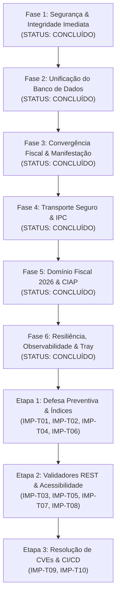

# Relatório 05: Plano de Execução e Roadmap em 6 Fases (Consolidado v3.5.2)

**Projeto:** `workspace-fiscal`  
**Versão:** v3.5.2  
**Status de Execução:** **100% CONCLUÍDO E HOMOLOGADO** em todas as 6 Fases de Engenharia e nas 3 Etapas de Hardening Pós-Auditoria.

---

## 1. Visão Geral das Fases Executadas

---

## 2. Resumo das Entregas por Fase

### Fase 1: Segurança & Integridade Imediata
- **Entregas Concluídas:** Token de autenticação `X-Workspace-Token` em `src/api/middleware/localAuth.ts`, comunicação PowerShell via `stdin` em memória, sanitização de caminhos contra Path Traversal em `pathSanitizer.ts` e cálculo de depreciação com precisão em centavos inteiros.
- **Status:** **Concluído e Homologado.**

### Fase 2: Unificação do Banco de Dados SQLite
- **Entregas Concluídas:** Schema Drizzle centralizado em `src/db/schema.ts`, eliminação do `sql.js`, migração transparente de bases legadas via `legacy-buscador-migration.ts`, modo WAL (`journal_mode = WAL`) com `busy_timeout = 5000` e backup atômico com formato `.wfb`.
- **Status:** **Concluído e Homologado.**

### Fase 3: Convergência Fiscal & Manifestação Automática
- **Entregas Concluídas:** Parsers fiscais unificados sob `src/core/parsers/`, disparo automático do evento 210210 (Ciência da Operação) na captura de resumos SEFAZ e unificação de ViewModels de DANFE/DACTE com sanitização HTML anti-XSS (`escapeHtml.ts`).
- **Status:** **Concluído e Homologado.**

### Fase 4: Transporte Seguro e Suporte Híbrido
- **Entregas Concluídas:** Suporte a portas dinâmicas e fallback transparente, proteção ponta a ponta com token criptográfico de sessão e comunicação IPC direta no ecossistema Electron.
- **Status:** **Concluído e Homologado.**

### Fase 5: Domínio Fiscal 2026 e Reforma Tributária
- **Entregas Concluídas:** Módulo utilitário `rtc-taxes.utils.ts` com extração e cálculo de IBS, CBS e Imposto Seletivo (IS), controle de CIAP e rateio de frete e despesas acessórias no imobilizado.
- **Status:** **Concluído e Homologado.**

### Fase 6: Resiliência, Observabilidade e Automações
- **Entregas Concluídas:** Suporte nativo a certificados A1 em memória, painel visual de logs de auditoria e telemetria (`ActivityLogsModal.tsx`), verificação de integridade e reparo de banco no boot (`verifyIntegrityOrRecover`) e agendamento de backups automáticos periódicos.
- **Status:** **Concluído e Homologado.**

---

## 3. Entregas das Etapas de Hardening Pós-Auditoria (IMP-T01 a IMP-T10)

1. **Etapa 1 — Segurança Preventiva, Índices SQLite e Event Loop:**
   - IMP-T01: Proteção Gzip Bomb (15 MB) em `compression.ts`. (Commit: `e57c3c5`)
   - IMP-T02: Guarda de tamanho máximo de XML (25 MB) em `base.parser.ts`. (Commit: `07e1ffe`)
   - IMP-T04: Índices compostos `idx_documents_batch_type` e `idx_documents_batch_issue_date` em `db-schema-init.ts`. (Commit: `2ee9836`)
   - IMP-T06: Cedência cooperativa do Event Loop (`setImmediate`) a cada 25 XMLs em `import.routes.ts`. (Commit: `9e7f35a`)

2. **Etapa 2 — Validadores REST, Testes de Backup e Otimização de UI:**
   - IMP-T03: Validadores tipados para `workspace`, `documents` e `settings` com HTTP 400 padronizado. (Commit: `190d074`)
   - IMP-T05: Testes unitários do módulo BUSCADOR em `backup-modules.test.ts`. (Commit: `f23e23e`)
   - IMP-T07: Memoização de `WorkspaceTreeNode` via `React.memo`. (Commit: `2b509eb`)
   - IMP-T08: Acessibilidade de `ConfirmDialog` com `useDialogFocus` e focus trap. (Commit: `93c9430`)

3. **Etapa 3 — Resolução de CVEs npm, CI/CD e Documentação:**
   - IMP-T09: Resolução de 100% das vulnerabilidades High/Critical via overrides e auditoria obrigatória no GitHub Actions. (Commit: `63fbfff`)
   - IMP-T10: Atualização integral dos 8 relatórios técnicos consolidando a versão final v3.5.2.
