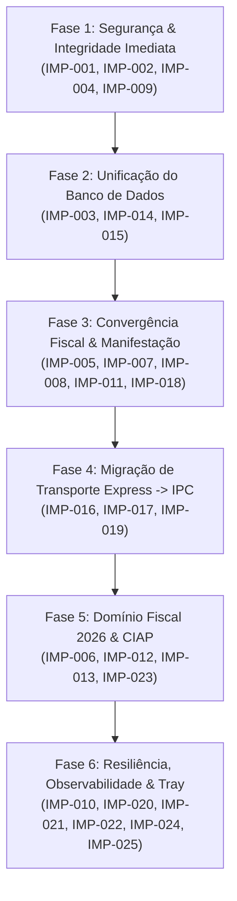

# Relatório 05: Plano de Execução e Roadmap em 6 Fases

**Projeto:** `workspace-fiscal`  
**Referência:** Auditoria Arquitetural v3.5.1  
**Diretriz:** Execução Modular, Sem Regressão, Validada por Testes Automatizados

---

## 1. Visão Geral das Fases

---

## 2. Detalhamento Fase a Fase

### Fase 1: Blindagem de Segurança e Integridade Imediata
- **Objetivo:** Mitigar riscos críticos imediatos sem alterar a arquitetura de persistência ou contratos existentes.
- **Entregáveis:**
  1. Token de sessão local (`X-Workspace-Token`) no Express e no cliente web.
  2. Passagem de envelopes e headers no PowerShell via `stdin`, eliminando arquivos em `%TEMP%`.
  3. Algoritmo de precisão em centavos no cálculo proporcional de depreciação sem divisões flutuantes duplas.
  4. Middleware e função utilitária `pathSanitizer` para blindar diretórios contra traversal.
- **Risco de Regressão:** Mínimo.
- **Critério de Saída:** 100% dos testes unitários e de integração passando; nenhuma escrita em disco temporário durante buscas mTLS.

---

### Fase 2: Unificação do Banco de Dados SQLite
- **Objetivo:** Eliminar a duplicidade de bancos de dados (`workspace-fiscal.sqlite` e `fiscal_storage.db`), unificando tudo sob Drizzle ORM.
- **Entregáveis:**
  1. Criação do schema consolidado em `src/db/schema.ts` contendo documentos, lotes, empresas e ativos.
  2. Script de migração transparente no primeiro boot para migrar dados do `fiscal_storage.db` legado.
  3. Configuração de `PRAGMA journal_mode = WAL` e `busy_timeout = 5000`.
  4. Rotina de backup atômica com `VACUUM INTO` em arquivo único consolidado.
- **Risco de Regressão:** Médio (necessidade de salvaguarda de dados existentes de clientes).
- **Critério de Saída:** Backup automático pré-migração; coexistência funcional sem perda de registros históricos de busca.

---

### Fase 3: Convergência dos Motores Fiscais e Manifestação SEFAZ
- **Objetivo:** Unificar parsers e renderizadores DANFE, e resolver o problema de XMLs incompletos ("Ciência da Operação").
- **Entregáveis:**
  1. Migração do Buscador para usar exclusivamente `src/core/parsers/`.
  2. Implementação do disparo automático de evento de Ciência da Operação (`210210`) para a SEFAZ.
  3. Unificação dos motores de layout DANFE/DACTE com `renderToStaticMarkup` do React.
  4. Suporte a DANFE Simplificado e layout de etiqueta para NFC-e.
- **Risco de Regressão:** Médio.
- **Critério de Saída:** XMLs da SEFAZ baixados com chave completa e protocolo de autorização (`procNFe`); paridade visual idêntica entre tela e PDF.

---

### Fase 4: Migração Gradual de Transporte (Express -> IPC Nativo)
- **Objetivo:** Reduzir a dependência do servidor HTTP local no desktop Electron, tornando as chamadas mais rápidas e imunes a conflitos de portas.
- **Entregáveis:**
  1. Handlers Electron IPC em `electron/buscador/ipc/` para documentos, ativos e categorias.
  2. `UnifiedApiClient` no frontend com detecção de ambiente (`window.fiscalApi ? IPC : HTTP`).
  3. Servidor Express tornado opcional em produção (mantido apenas em desenvolvimento Vite).
- **Risco de Regressão:** Baixo (arquitetura em camadas com fallback automático).
- **Critério de Saída:** Aplicação desktop funcionando de ponta a ponta sem necessidade de subir porta TCP local.

---

### Fase 5: Domínio Fiscal Avançado e Reforma Tributária 2026
- **Objetivo:** Preparar o software para as exigências fiscais da Emenda Constitucional 132/2023 e cálculos contábeis complexos de ativo.
- **Entregáveis:**
  1. Extração e tipagem dos novos campos fiscais: IBS, CBS e Imposto Seletivo (IS).
  2. Módulo de rateio de frete e custos adicionais (CT-e) no valor de aquisição de bens do imobilizado.
  3. Fila de download com rate-limiting inteligente para evitar bloqueios de consumo indevido na SEFAZ (Rejeição 656).
- **Risco de Regressão:** Baixo.
- **Critério de Saída:** XMLs com tags 2026 parseados com sucesso e exibidos nos resumos fiscais; rateio de CT-e calculando cotas ajustadas.

---

### Fase 6: Observabilidade, Resiliência e Automações
- **Objetivo:** Robustez corporativa, suporte a certificados sem PowerShell e automação contínua.
- **Entregáveis:**
  1. Provedor nativo para certificados A1 `.pfx` em memória via TLS padrão do Node.js.
  2. Resiliência com Circuit Breaker e backoff exponencial em instabilidades da SEFAZ/ADN.
  3. Painel visual unificado de auditoria e telemetria operacional com exportação.
  4. Módulo de geração e exportação de arquivo do Bloco G do SPED Fiscal.
  5. Agendador em segundo plano com ícone na bandeja do sistema (System Tray).
- **Risco de Regressão:** Baixo.
- **Critério de Saída:** Aplicação operando silenciosamente na bandeja, capturando documentos sem travamentos e com logs detalhados.

