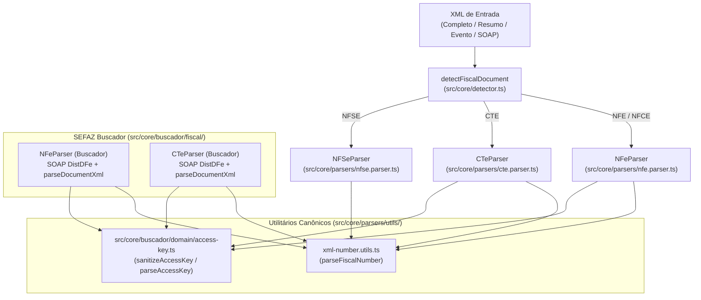
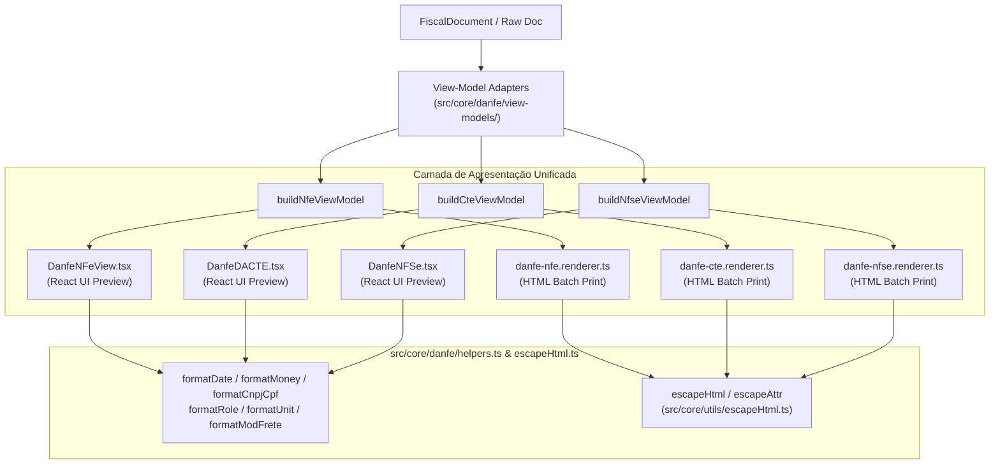
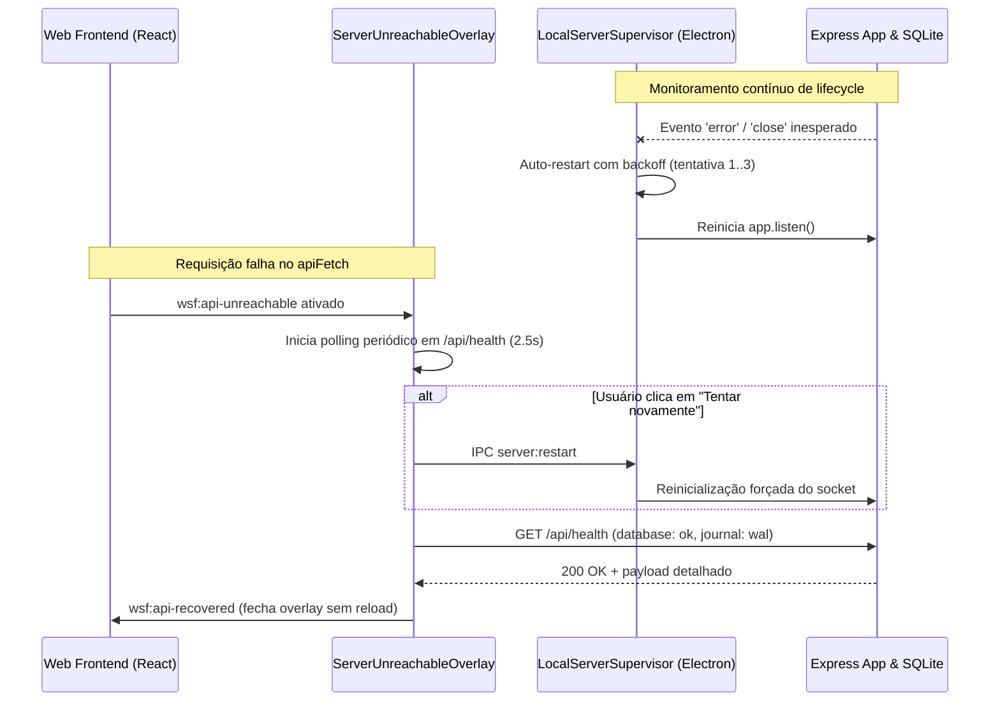

# Fase 3: Unificação de Motores e Resiliência da Camada de Transporte — Especificação de Design

- **Data**: 2026-10-14
- **Status**: Proposta para Validação (Abordagem Modular com Retrocompatibilidade Segura)
- **Escopo**: IMP-005, IMP-008, IMP-022
- **Restrições**: Zero quebras nos contratos existentes de `DistributionEngine.ts`, `import.service.ts` e IPC do Buscador; 100% de retrocompatibilidade com as 61 suítes de testes (369 testes); sem push ao Git remoto.

---

## 1. Visão Geral e Objetivos

A Fase 3 encerra o ciclo de modernização da base de código do **Workspace Fiscal**, atacando as três dívidas técnicas de processamento e comunicação:
1. **IMP-005 (Parsers e Utilitários XML)**: Eliminar a bifurcação de regras de negócio entre `src/core/parsers/` (NFView/Express) e `src/core/buscador/fiscal/` (Buscador SEFAZ/Electron), garantindo suporte bidirecional para documentos completos (`nfeProc`, `cteProc`) e resumos (`resNFe`, `resCTe`, `resEvento`), além da unificação de utilitários numéricos.
2. **IMP-008 (Formatadores, View-Models e Blindagem XSS)**: Eliminar a duplicação de formatadores e lógica de apresentação entre os renderizadores HTML de impressão em lote (`src/core/danfe/renderers/`) e os componentes React de visualização (`src/web/features/documents/`), unificando a camada em View-Models tipados e blindando 100% das interpolações contra injeção de HTML/XSS.
3. **IMP-022 (Resiliência da Camada de Transporte)**: Proteger a comunicação local entre a interface web e a API Express contra quedas silenciosas por meio de um Supervisor de Servidor Local no Electron com auto-restart controlado, enriquecimento do probe `/api/health`, auto-recuperação inteligente no `ServerUnreachableOverlay.tsx` e endurecimento rigoroso de validação de remetente e caminhos no IPC.

---

## 2. IMP-005: Unificação de Parsers e Utilitários XML

### 2.1. Problema Atual
- **Utilitários numéricos duplicados**: `parseCteNumber` (`src/core/parsers/cte/cte-number.utils.ts`) e `parseNfseNumber` (`src/core/parsers/nfse/nfse-number.utils.ts`) possuem código idêntico.
- **Incompatibilidade com Resumos na Importação**: O parser principal `src/core/parsers/nfe.parser.ts` exige a tag `infNFe`, falhando com erro se o usuário tentar importar um XML de resumo SEFAZ (`resNFe` ou `resEvento`). O mesmo ocorre com `cte.parser.ts` e `resCTe`.
- **Detecção Incompleta**: `detectFiscalDocument` em `src/core/detector.ts` não reconhece `<resNFe` nem `<resCTe`, retornando `UNKNOWN`.
- **Duplicação no Buscador**: `src/core/buscador/fiscal/nfe/NFeParser.ts` e `CTeParser.ts` reimplementam extração de números e datas sem reaproveitar utilitários canônicos.

### 2.2. Arquitetura da Solução



### 2.3. Detalhamento Técnico
1. **Utilitário Canônico `src/core/parsers/utils/xml-number.utils.ts`**:
   - Função `parseFiscalNumber(val: unknown): number`: trata números inteiros, floats com ponto, strings brasileiras com vírgula (`1.234,56` e `1234,56`), nulos e strings vazias.
   - `cte-number.utils.ts` e `nfse-number.utils.ts` reexportam `parseFiscalNumber` como `parseCteNumber` e `parseNfseNumber` garantindo compatibilidade estrita.
2. **Atualização em `src/core/detector.ts`**:
   - Detecção de `<resnfe` como `NFE` e `<rescte` como `CTE`.
3. **Suporte a Resumos em `NFeParser` (`src/core/parsers/nfe.parser.ts`)**:
   - Reconhecimento de `jsonObj.resNFe`:
     - `type: 'NFE'`, `status: 'VALID'`, `accessKey` extraída e validada.
     - `issuer`: CNPJ/CPF e Razão Social do emitente do resumo.
     - `items`: 1 item sintético `Resumo de NF-e (Aguardando manifesto ou download integral)`.
     - `totals`: `products: vNF`, `total: vNF`.
     - `situacao_fiscal`: `AUTORIZADA`, `CANCELADA` (se `cSitNFe === 2`) ou `DENEGADA` (se `cSitNFe === 3`).
   - Reconhecimento de `jsonObj.resEvento`:
     - Mapeamento adequado para `FiscalDocument` com tipo de evento, protocolo e data.
4. **Suporte a Resumos em `CTeParser` (`src/core/parsers/cte.parser.ts`)**:
   - Reconhecimento de `jsonObj.resCTe` e `jsonObj.resEventoCTe`, gerando `FiscalDocument` coerente.
5. **Harmonização do Buscador (`src/core/buscador/fiscal/`)**:
   - `NFeParser.ts` e `CTeParser.ts` do Buscador passam a utilizar o `parseFiscalNumber` unificado, eliminando inconsistências na conversão de decimais.
   - Contratos de `parseDistDFeResponse` e `parseDocumentXml` permanecem inalterados para total estabilidade do `DistributionEngine.ts`.

---

## 3. IMP-008: Convergência de Formatadores, View-Models e Blindagem XSS

### 3.1. Problema Atual
- **Formatadores duplicados**: `formatRole` e `formatUnit` em `src/core/danfe/renderers/danfe-cte.renderer.ts` foram duplicados em `src/web/features/documents/dacte/dacte.helpers.ts`.
- **Inversão de Camadas**: `src/core/danfe/renderers/danfe-nfe.renderer.ts` importa `escapeHtml` de `src/api/utils/escapeHtml.ts`, fazendo o Core depender da camada de API.
- **Lógica de View-Model Duplicada**:
  - `DanfeNFSe.tsx` (React) e `danfe-nfse.renderer.ts` (HTML string) repetem 70 linhas de regras para extrair prestador, tomador, retenções de impostos e valores dedutíveis.
  - O mesmo ocorre entre `DanfeDACTE.tsx` / `dacte/` e `danfe-cte.renderer.ts`.
- **Risco de XSS em HTML Renderers**: Interpolações diretas de strings em templates de impressão em lote sem passagem por `escapeHtml`.

### 3.2. Arquitetura da Solução



### 3.3. Detalhamento Técnico
1. **Inversão Segura de Dependência**:
   - `escapeHtml` e `escapeAttr` residem em `src/core/utils/escapeHtml.ts` e são reexportados em `src/core/danfe/helpers.ts`.
   - `src/api/utils/escapeHtml.ts` apenas reexporta de `src/core/utils/escapeHtml.ts`, normalizando a arquitetura em camadas.
2. **Centralização de Formatadores Fiscais**:
   - `formatRole` e `formatUnit` passam a ser funções canônicas em `src/core/danfe/helpers.ts`.
   - `src/web/features/documents/dacte/dacte.helpers.ts` passa a reexportá-los diretamente de `src/core/danfe/helpers.ts`.
3. **Camada de View-Models (`src/core/danfe/view-models/`)**:
   - `nfse.view-model.ts`: extrai prestador, tomador, dados do serviço (código, CNAE, município), valores brutos, deduções, base e retenção de ISS.
   - `cte.view-model.ts`: extrai emitente, remetente, destinatário, expedidor, recebedor, tomador normalizado, componentes do frete e modal rodoviário.
   - `nfe.view-model.ts`: consolida emitente, destinatário, duplicatas/faturas, transporte e totais de impostos.
4. **Blindagem XSS**:
   - Todos os renderizadores de string HTML (`danfe-nfe.renderer.ts`, `danfe-cte.renderer.ts`, `danfe-nfce.renderer.ts`, `danfe-nfse.renderer.ts`, `danfe-card.dispatcher.ts`) utilizam `escapeHtml` sistematicamente em todas as interpolações.
   - Criação de suíte de testes de estresse XSS validando que payloads maliciosos (`<script>`, `onerror=`, tags HTML) não sejam injetados no DOM final.

---

## 4. IMP-022: Resiliência da Camada de Transporte (HTTP Local / IPC)

### 4.1. Problema Atual
- **Queda Silenciosa do Express**: No processo principal do Electron (`electron/main.ts`), o Express é iniciado de forma estática. Não há tratamento de erros no servidor HTTP nem rotina de auto-restart caso o processo caia ou perca a porta.
- **Probe `/api/health` Raso**: O endpoint `/api/health` não inspeciona a saúde do banco SQLite nem métricas de execução.
- **Overlay Sem Auto-Recuperação**: `ServerUnreachableOverlay.tsx` depende de `window.location.reload()`, falhando se o backend local não estiver respondendo.
- **Vulnerabilidade em Handlers IPC Nativos**: Handlers de sistema de arquivos e caixas de diálogo em `electron/main.ts` não validam se o `senderFrame` é exatamente o `mainFrame` da janela autorizada.
- **Validação de Pastas no Buscador**: `isApprovedFolder` em `electron/buscador/ipc/security.ts` não aproveita o `pathSanitizer.ts` da Fase 1 para prevenção de directory traversal.

### 4.2. Arquitetura da Solução



### 4.3. Detalhamento Técnico
1. **Supervisor de Servidor Local (`electron/serverSupervisor.ts`)**:
   - Classe `LocalServerSupervisor`:
     - Gerencia ciclo de vida do servidor `http.Server`.
     - Event listeners para `'error'` e `'close'`.
     - Estratégia de auto-restart com backoff exponencial (500ms, 1500ms, 3000ms), com máximo de 3 tentativas consecutivas antes de declarar erro fatal.
     - Métodos: `start(): Promise<number>`, `stop(): Promise<void>`, `restart(): Promise<number>`, `getStatus(): ServerStatus`.
     - Emite eventos IPC para o renderizador caso a porta seja realocada: `server:url-changed`.
2. **Endpoint `/api/health` Enriquecido (`src/api/app.ts`)**:
   - Executa `SELECT 1;` e consulta `PRAGMA journal_mode;` no banco ativo.
   - Retorna:
     ```json
     {
       "status": "ok",
       "service": "nf-view-api",
       "version": "3.5.1",
       "uptime": 128.4,
       "timestamp": "2026-10-14T11:00:00.000Z",
       "database": {
         "connected": true,
         "journalMode": "wal"
       },
       "memory": {
         "rssMb": 48.6,
         "heapUsedMb": 25.3
       }
     }
     ```
   - Caso o banco falhe, retorna HTTP 503 com `{ status: "degraded", database: { connected: false, error: "..." } }`.
   - Permanece 100% liberado de autenticação no `localAuthMiddleware`.
3. **Resiliência e Auto-Recuperação no Frontend**:
   - Em `src/web/lib/api.ts`: suporte ao evento `wsf:api-recovered` que limpa o status de inalcançável e atualiza o `_cachedApiBaseUrl` se a porta mudou.
   - Em `src/web/components/ServerUnreachableOverlay.tsx`:
     - Polling inteligente enquanto o overlay estiver visível (a cada 2.5s).
     - Se `/api/health` responder com sucesso, recupera a interface automaticamente sem perda do estado de tela do usuário.
     - Botão "Tentar novamente": invoca `window.api?.restartServer?.()` via IPC e sonda imediatamente a rota de saúde.
4. **Endurecimento de IPC e Validação de Origem**:
   - Em `electron/main.ts`: criar helper `registerVerifiedHandler` que valida:
     ```ts
     if (!mainWindow || event.sender !== mainWindow.webContents || event.senderFrame !== mainWindow.webContents.mainFrame) {
       throw new Error('Origem IPC não autorizada.');
     }
     ```
     e aplicá-lo a todos os handlers nativos de diálogo e sistema de arquivos (`dialog:*`, `fs:*`).
   - Em `electron/buscador/ipc/security.ts`:
     - Utilizar `isPathSafe` e `assertInsideDirectory` de `src/core/security/pathSanitizer.ts` dentro de `isApprovedFolder` e na validação de diretórios de armazenamento.
   - Em `electron/preload.ts`: expor `restartServer` e `getServerStatus` em `window.api`.

---

## 5. Matriz de Trade-offs e Decisões

| Decisão | Alternativa Descartada | Justificativa |
|---|---|---|
| **Resumos de DF-e como `FiscalDocument` com Item Sintético** | Rejeitar arquivos `resNFe`/`resCTe` no importador do NFView | Empresas frequentemente recebem pacotes de XML contendo resumos antes da manifestação. Descartar causaria erros opacos no importador. O item sintético preserva a visualização da timeline e valores contábeis. |
| **View-Models sob Demanda (Lazy)** | Substituir a tipagem `FiscalDocument` das stores por View-Models | Manter as stores operando com `FiscalDocument` evita refatorações arriscadas no banco e no estado do Zustand; os View-Models são instanciados apenas no momento do render do preview ou do lote. |
| **Supervisor de Servidor no Main Process** | Subprocesso `child_process.fork()` separado para o Express | Executar em processo separado aumentaria o consumo de memória em 40-60 MB e duplicaria handles do SQLite no Windows; manter no processo Electron com o supervisor garante isolamento suficiente com baixo consumo de recursos. |
| **Polling com Auto-Recuperação no Overlay** | Forçar recarregamento imediato (`window.location.reload()`) | O recarregamento forçado destrói formulários abertos e seleções do usuário; a auto-recuperação sem reload proporciona UX nativa e resiliente. |

---

## 6. Plano de Não-Regressão e Critérios de Aceite

1. **Testes Unitários de Parsers e Utilitários (IMP-005)**:
   - Suíte `xml-number.test.ts` cobrindo todas as variações numéricas brasileiras.
   - Teste de ingestão de `resNFe` e `resCTe` no `nfe.parser.test.ts` e `cte.parser.test.ts`.
   - Teste de `detectFiscalDocument` com tags de resumo.
   - Testes do `DistributionEngine.ts` permanecem 100% passando.
2. **Testes de Formatadores, View-Models e XSS (IMP-008)**:
   - Suíte de View-Models para NFS-e, CT-e e NF-e validando extração idêntica entre React e HTML.
   - Suíte de estresse XSS injetando tags em todos os campos textuais e validando escape nos renderizadores de lote.
   - Suíte `danfe-html.test.ts` 100% verde.
3. **Testes de Resiliência de Transporte e IPC (IMP-022)**:
   - Suíte do `LocalServerSupervisor` testando inicialização, detecção de encerramento e restart com backoff.
   - Suíte da rota `/api/health` testando retorno 200 (com diagnóstico do SQLite) e retorno 503 quando degradado.
   - Teste do `ServerUnreachableOverlay` validando polling e auto-recuperação.
   - Testes de segurança de IPC validando bloqueio para frames não autorizados.
4. **Verificação de Regressão Global**:
   - Execução de todas as suítes (`npm test`), validação de lint (`npm run lint`) e compilação de produção (`npm run build`).

