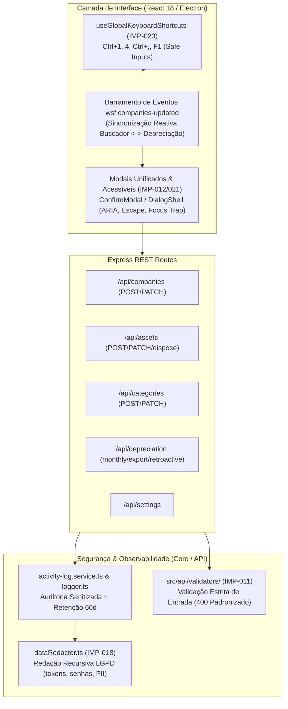

# Fase 4: Consolidação de UX/UI, Validação de Contratos API/IPC e Observabilidade Segura LGPD — Especificação de Design

- **Data**: 2026-10-14
- **Status**: Em Revisão / Proposta
- **Escopo**: IMP-011, IMP-012, IMP-018, IMP-021, IMP-023
- **Restrições**: 100% de retrocompatibilidade com as 68 suítes (398 testes) existentes; zero regressão no banco SQLite unificado e nos motores de parser/renderização da Fase 1, 2 e 3.

---

## 1. Visão Geral e Objetivos Arquiteturais

A Fase 4 fecha o ciclo de modernização e robustez da plataforma multi-módulo `workspace-fiscal`, focando na camada de contato com o usuário (UX/UI e acessibilidade), na segurança de dados conforme a LGPD (redação de dados sensíveis e auditoria resiliente) e na validação estrita de contratos de entrada de ponta a ponta (Express REST API e Electron IPC).



---

## 2. IMP-011: Validação Rigorosa de Contratos de Entrada API/IPC

### 2.1. Problema Atual
- Atualmente, as rotas de escrita do Express (`companies.routes.ts`, `assets.routes.ts`, `categories.routes.ts`, `depreciation.routes.ts`, `settings.routes.ts`) contêm validações dispersas e incompletas.
- Métodos `PATCH` (`/api/companies/:id`, `/api/assets/:id`, `/api/categories/:id`) aceitam propriedades indefinidas ou malformadas sem validação de tipos ou valores de contorno (ex: taxas de depreciação negativas ou acima de 100%, CNPJs inválidos, strings de nomes vazias).
- As respostas de erro variam entre `{ error: string }`, `{ message: string }`, e respostas 500 para falhas que deveriam ser 400 Bad Request.

### 2.2. Arquitetura da Solução
Criação do módulo `src/api/validators/` com esquemas de validação puras, determinísticas e sem dependências pesadas externas:

1. **`src/api/validators/company.validator.ts`**:
   - `validateCreateCompany(body: unknown): ValidationResult<CreateCompanyInput>`
   - `validateUpdateCompany(body: unknown): ValidationResult<UpdateCompanyInput>`
   - Regras:
     - `name`: obrigatório na criação, string trimmed de 1 a 255 caracteres.
     - `cnpj` / `document`: normalizado com `sanitizeCNPJ(doc)`. Obrigatório na criação se fornecido; se informado, deve possuir exatamente 14 dígitos e passar pelo cálculo de dígitos verificadores `isValidCNPJ`.
     - `state`: se fornecido, deve pertencer à lista oficial de 27 UFs brasileiras (`BRAZILIAN_UFS`).
     - `depreciationRule`: se fornecido, deve ser estritamente `'MONTH_OF_ACQUISITION' | 'NEXT_MONTH' | 'PROPORTIONAL'`.

2. **`src/api/validators/asset.validator.ts`**:
   - `validateCreateAsset(body: unknown): ValidationResult<CreateAssetInput>`
   - `validateUpdateAsset(body: unknown): ValidationResult<UpdateAssetInput>`
   - `validateDisposeAsset(body: unknown): ValidationResult<DisposeAssetInput>`
   - Regras:
     - `companyId`: UUID/string não vazia.
     - `supplier`, `documentNumber`, `description`: strings não vazias (1..255 caracteres).
     - `acquisitionDate`: data ISO ou formato `YYYY-MM-DD` válida, entre ano 1970 e data futura razoável.
     - `acquisitionValue`: conversão segura para centavos inteiros (`finalCents > 0`). Valores negativos ou zero disparam erro 400 imediato.
     - `annualRate`: número `0 < rate <= 100`.
     - No `dispose`: `disposedAt` data válida; `reason` string opcional <= 500 chars.

3. **`src/api/validators/category.validator.ts`**:
   - `name`: 1..100 caracteres.
   - `defaultRate`: número `0 < rate <= 100`.

4. **`src/api/validators/depreciation.validator.ts`**:
   - `competence`: regex estrito `/^\d{4}-(0[1-9]|1[0-2])$/`.
   - `separator`: restrito a `';' | ','`.
   - `numericFormat`: restrito a `'BRL' | 'RAW'`.
   - `dateFormat`: restrito a `'DD/MM/YYYY' | 'YYYY-MM-DD'`.

5. **Formato Padronizado de Resposta de Erro**:
   ```json
   {
     "error": "Dados de entrada inválidos",
     "details": [
       "CNPJ inválido: dígitos verificadores incorretos",
       "A taxa anual deve ser maior que 0 e menor ou igual a 100%"
     ]
   }
   ```

---

## 3. IMP-018: Redação de Dados Sensíveis LGPD nos Logs e Auditoria

### 3.1. Problema Atual
- Logs do Pino (`src/api/utils/logger.ts`) redactam apenas propriedades fixas (`req.headers.authorization`, `xmlContent`), deixando passar o token de segurança local `x-workspace-token`, senhas de arquivos PFX/P12 (`certPassword`), segredos e eventuais chaves de acesso privadas.
- O `ActivityLogService` (`src/api/services/activity-log.service.ts`) persiste objetos `details` diretamente em formato JSON no SQLite sem qualquer filtro LGPD. Se um usuário ou processo gravar um payload contendo senha ou token, ele fica vulnerável no banco e em exportações CSV/JSON.

### 3.2. Arquitetura da Solução

1. **Motor de Redação Recursivo (`src/core/security/dataRedactor.ts`)**:
   - Implementa `redactSensitiveData(target: unknown, depth = 0): unknown`.
   - Suporte a objetos literais, arrays, mapas, strings e valores primitivos.
   - Proteção contra referências circulares via `WeakSet`.
   - Chaves redactadas (insensível a maiúsculas/minúsculas):
     ```ts
     const SENSITIVE_KEY_PATTERNS = [
       /password/i, /senha/i, /pass/i,
       /token/i, /apitoken/i, /x-workspace-token/i,
       /authorization/i, /secret/i, /private[-_]?key/i,
       /pfx/i, /cert[-_]?password/i, /client[-_]?secret/i,
     ];
     ```
   - Sanitização de valores em strings:
     - Regex para chaves privadas PEM: `-----BEGIN [A-Z ]*PRIVATE KEY-----[\s\S]*?-----END [A-Z ]*PRIVATE KEY-----` -> `[REDACTED PRIVATE KEY]`.
     - Regex para tokens hexadecimais longos (64 caracteres do `X-Workspace-Token`) e JWTs.

2. **Integração no `logger.ts`**:
   - Inclusão de `req.headers.x-workspace-token`, `*.password`, `*.token`, `*.pfx`, `*.privateKey` na configuração `redact.paths` do Pino.
   - Serializer de request e error sanitizados.

3. **Integração no `ActivityLogService`**:
   - No método `record(input: ActivityLogInput)`:
     ```ts
     const sanitizedDetails = redactSensitiveData(input.details);
     const sanitizedMessage = redactSensitiveString(input.message);
     ```
   - Garante que dados salvos na tabela SQLite `activity_logs` e exportados em `exportCsv` / `exportJson` já estejam 100% livres de dados sensíveis LGPD.
   - Manutenção da política de retenção via `clearOld(retentionDays = 60)`.

---

## 4. IMP-012 & IMP-021: Convergência de Modais, Sincronização e Acessibilidade

### 4.1. Problema Atual
- `ConfirmModal.tsx` no NFView não possui acessibilidade WAI-ARIA (`role="dialog"`, `aria-modal="true"`), não fecha com tecla `Escape` e não possui focus trap (usuário pode pressionar Tab e interagir com elementos atrás do modal).
- `CompanyModal.tsx` na Depreciação não aplica máscara de CNPJ, não valida dígitos e não sincroniza com o Buscador.
- Empresas criadas em um módulo exigem recarregar a tela para aparecer no outro módulo, quebrando a experiência de Hub Unificado.

### 4.2. Arquitetura da Solução

1. **Acessibilidade Universal de Diálogos (`src/web/hooks/useDialogFocus.ts`)**:
   - Centralizar `useDialogFocus` em `src/web/hooks/useDialogFocus.ts` (reexportando no Buscador).
   - Aplicar `useDialogFocus` em `ConfirmModal.tsx`:
     - Suporte a tecla `Escape` para cancelamento.
     - Captura de foco inicial no botão de cancelamento ou no input (quando `requireText` for usado).
     - Focus trap circular: ao pressionar `Tab` no último elemento, volta ao primeiro; `Shift+Tab` no primeiro leva ao último.
     - Fechamento ao clicar fora (backdrop click via `onMouseDown`).
     - Atributos `role="dialog"`, `aria-modal="true"`, `aria-labelledby="confirm-modal-title"`.

2. **Compartilhamento de Utilitários Fiscais de Empresa (`src/core/fiscal/`)**:
   - Consolidar em `src/core/fiscal/cnpj.ts` (`formatCNPJ`, `isValidCNPJ`, `sanitizeCNPJ`) e `src/core/fiscal/uf.ts` (`BRAZILIAN_UFS`, `getUfAcronym`).
   - Atualizar `src/web/features/depreciation/components/modals/CompanyModal.tsx`:
     - Máscara dinâmica de CNPJ (`00.000.000/0000-00`).
     - Validação antes de submeter (`isValidCNPJ`).
     - Campo de seleção de Estado (UF) oficial.
     - Inclusão de `role="dialog"`, `aria-modal="true"` e focus trap via `DialogShell` ou `useDialogFocus`.

3. **Barramento de Sincronização Reativa (`wsf:companies-updated`)**:
   - Sempre que uma empresa for salva, editada ou removida (no Buscador ou na Depreciação), dispara:
     ```ts
     window.dispatchEvent(new CustomEvent('wsf:companies-updated', { detail: { companyId, action } }));
     ```
   - Tanto `DepreciationApp.tsx` quanto `BuscadorApp.tsx` registram listeners para esse evento, recarregando automaticamente suas listas de empresas sem necessidade de reload de página ou perda do estado local do usuário.

---

## 5. IMP-023: Atalhos Globais de Produtividade

### 5.1. Problema Atual
- Atalhos de teclado estão confinados a `MainLayout.tsx` e misturam navegação de lista com atalhos de sistema.
- Não existem atalhos globais no nível do aplicativo (`App.tsx`) para alternar rapidamente entre o Hub Principal e os três módulos (`NFView`, `Depreciação`, `Buscador`), nem para abrir Configurações.
- Risco de interferência: se um atalho for pressionado enquanto o usuário digita em um campo de texto, o caractere pode ser interceptado indevidamente.

### 5.2. Arquitetura da Solução

1. **Criação do Hook `src/web/hooks/useGlobalKeyboardShortcuts.ts`**:
   - Mapeamento padrão de atalhos:
     | Atalho | Ação | Escopo |
     |---|---|---|
     | `Ctrl+1` / `Cmd+1` | Navegar para o Hub Principal (`home`) | Global |
     | `Ctrl+2` / `Cmd+2` | Navegar para o Workspace de Documentos (`nfview`) | Global |
     | `Ctrl+3` / `Cmd+3` | Navegar para o Controle de Depreciação (`depreciation`) | Global |
     | `Ctrl+4` / `Cmd+4` | Navegar para o Buscador Fiscal (`buscador`) | Global |
     | `Ctrl+,` / `Cmd+,` | Abrir modal de Configurações Gerais | Global |
     | `F1` / `Ctrl+H` | Abrir modal "O que há de novo / Ajuda" | Global |
   - **Guarda de Foco Segura (`isEditableTarget`)**:
     ```ts
     function isEditableTarget(target: EventTarget | null): boolean {
       if (!(target instanceof HTMLElement)) return false;
       const tagName = target.tagName.toLowerCase();
       if (tagName === 'input' || tagName === 'textarea' || tagName === 'select') return true;
       if (target.isContentEditable || target.getAttribute('contenteditable') === 'true') return true;
       return false;
     }
     ```
   - Para atalhos combinados com modificadores (`Ctrl` / `Cmd`), a navegação é executada com segurança mesmo se o foco estiver em inputs; atalhos de caractere simples (como `/` para busca) são estritamente ignorados se o usuário estiver digitando.
   - Ativação centralizada no `App.tsx`.

---

## 6. Matriz de Trade-offs e Decisões

| Decisão | Alternativa Descartada | Justificativa |
|---|---|---|
| **Validadores Próprios Tipados sem Dependência Externa (Zod/Joi)** | Adicionar pacote `zod` ou `joi` ao projeto | O repositório opera em ambiente desktop empacotado pelo Electron/Vite com TypeScript estrito. Criar validadores nativos focados em regras fiscais/contábeis economiza bundle size, elimina dependências de runtime e garante performance máxima com zero risco de quebra de build. |
| **Redação em Tempo de Ingestão (`record` e `logger`)** | Filtrar dados apenas na exibição da UI | Redigir na UI deixaria senhas e tokens salvos em texto claro no SQLite e nos logs em disco, violando frontalmente a LGPD. A redação na camada de entrada e no logger garante que nenhum segredo atinja o disco físico. |
| **Sincronização Reativa via DOM Events (`wsf:companies-updated`)** | Migrar todo o estado de empresas para uma store Zustand global única | Uma store global única exigiria refatorar simultaneamente o Buscador e a Depreciação, arriscando quebrar contratos estabelecidos. Eventos CustomEvent leves conectam os módulos de forma desacoplada e 100% segura. |
| **Focus Trap Manual via Hook Acessível (`useDialogFocus`)** | Instalar biblioteca externa como `@radix-ui/react-dialog` | A base de código já possui uma implementação comprovada de `useDialogFocus` no Buscador; compartilhá-la em todo o frontend garante acessibilidade WAI-ARIA sem introduzir novas dependências no React. |

---

## 7. Estratégia de Testes (TDD Estrito)

1. **`src/api/validators/validators.test.ts`**:
   - Teste unitário exaustivo para CNPJ válido vs inválido, alíquotas negativas/maiores que 100%, datas inválidas e payloads vazios em empresas, bens, categorias e depreciação.
2. **`src/core/security/dataRedactor.test.ts`**:
   - Validação de mascaramento recursivo de `password`, `token`, `x-workspace-token`, `pfx`, JWTs e blocos PEM.
   - Verificação de preservação de campos não sensíveis e integridade de estruturas aninhadas.
3. **`src/api/routes/validation-routes.test.ts`**:
   - Testes de integração HTTP confirmando que rotas `POST`/`PATCH` rejeitam inputs malformados com HTTP 400 padronizado.
4. **`src/web/hooks/useGlobalKeyboardShortcuts.test.ts`**:
   - Teste de disparo de atalhos e confirmação de isolamento quando elementos editáveis estão em foco.
5. **`src/web/components/ConfirmModal.test.ts`**:
   - Validação de atributos ARIA e comportamento de cancelamento com tecla `Escape`.

