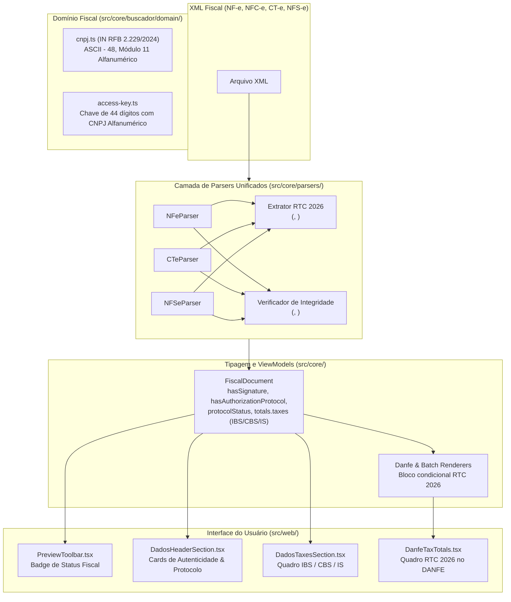

# Fase 5: Conformidade Fiscal e Tributária 2026 — Especificação de Design

- **Data**: 2026-10-14
- **Status**: Proposta para Aprovação
- **Escopo**: IMP-006, IMP-016 e IMP-019
- **Escopo Excluído**: IMP-024, FUNC-03 e FUNC-04 (conforme instrução do usuário)
- **Base Técnica**: 75 suítes aprovadas (100%), 444 testes verdes, zero erros de lint e build limpo.

---

## 1. Visão Geral e Objetivos

A **Fase 5** tem como objetivo alinhar o **Workspace Fiscal** aos requisitos de conformidade tributária e técnica vigentes e projetados para **2026**, abrangendo:
1. **Reforma Tributária sobre o Consumo (RTC 2026 - EC 132/2023)**: Extração e apresentação dos novos tributos dual (IBS - Imposto sobre Bens e Serviços, CBS - Contribuição sobre Bens e Serviços) e do Imposto Seletivo (IS).
2. **Novo Padrão de CNPJ Alfanumérico (IN RFB nº 2.229/2024)**: Suporte completo ao formato `[A-Z0-9]{12}[0-9]{2}` no domínio do CNPJ e cálculo estendido do Módulo 11 nas Chaves de Acesso de 44 dígitos da SEFAZ.
3. **Integridade e Validade Jurídica de Documentos Fiscais**: Identificação e exposição visual explícita de assinatura digital XML (`<Signature>`) e de protocolo de autorização da SEFAZ/Prefeitura (`<protNFe>`, `<protCTe>`, `<infProt>`), diferenciando notas plenamente autorizadas de rascunhos, resumos ou documentos sem autorização.

---

## 2. Detalhamento dos Componentes e Arquitetura



---

## 3. Especificação Técnica por Item

### 3.1. [IMP-006] Reforma Tributária 2026: IBS, CBS e Imposto Seletivo (IS)

#### 3.1.1. Modelos de Dados e Tipagem (`src/core/fiscal.types.ts`)
Estender `FiscalTaxes` e `FiscalItem` com campos dedicados:
```typescript
export interface FiscalTaxes {
  // ... campos existentes (icms, ipi, pis, cofins, iss, etc.) ...
  
  // Reforma Tributária RTC 2026 (EC 132/2023)
  ibs?: number;
  ibsBase?: number;
  ibsAliq?: number;
  cbs?: number;
  cbsBase?: number;
  cbsAliq?: number;
  is?: number;
  isBase?: number;
  isAliq?: number;
  
  [key: string]: number | boolean | undefined;
}

export interface FiscalItem {
  // ... campos existentes (code, description, quantity, unitPrice, etc.) ...
  
  // Reforma Tributária RTC 2026
  ibsBase?: number;
  ibsAliq?: number;
  ibsValue?: number;
  cbsBase?: number;
  cbsAliq?: number;
  cbsValue?: number;
  isBase?: number;
  isAliq?: number;
  isValue?: number;
}
```

#### 3.1.2. Parsers XML
1. **NF-e / NFC-e (`src/core/parsers/nfe.parser.ts`)**:
   - **Itens (`parseItems`)**:
     - Localizar `<imposto><IBSCBS>` ou `<imposto><IBS>` e `<imposto><CBS>`:
       - Extrair `vBCIBS`, `pIBS`, `vIBS` -> `ibsBase`, `ibsAliq`, `ibsValue`.
       - Extrair `vBCCBS`, `pCBS`, `vCBS` -> `cbsBase`, `cbsAliq`, `cbsValue`.
     - Localizar `<imposto><IS>`:
       - Extrair `vBCIS`, `pIS`, `vIS` -> `isBase`, `isAliq`, `isValue`.
   - **Totais (`parseTotals`)**:
     - Localizar `<total><IBSCBSTot>` ou `<total><IBSCBS>`:
       - Extrair totais `vIBS`, `vCBS`, `vBCIBS`, `vBCCBS`.
     - Localizar `<total><ISTot>` ou `<total><IS>`:
       - Extrair total `vIS`, `vBCIS`.
     - Atribuir em `taxes.ibs`, `taxes.cbs`, `taxes.is`, etc.
2. **CT-e (`src/core/parsers/cte/cte-fiscal.parser.ts`)**:
   - Localizar nós correspondentes a IBS/CBS/IS em `imp.infTribFed` ou `imp.IBSCBS`.
3. **NFS-e (`src/core/parsers/nfse/nfse-sefin.parser.ts`)**:
   - Extrair valores de IBS e CBS em `valores.tribFed` ou `valores.IBSCBS` quando disponíveis no padrão nacional.

#### 3.1.3. Visualização e Renderizadores
1. **`DadosTaxesSection.tsx`**:
   - Renderizar cards dedicados para **IBS**, **CBS** e **Imposto Seletivo (IS)** exibindo valor, base de cálculo e alíquota.
   - **Condição estrita**: Renderizar **somente se** `doc.totals?.taxes?.ibs || doc.totals?.taxes?.cbs || doc.totals?.taxes?.is` estiverem presentes e com valor > 0.
   - **Retrocompatibilidade**: 100% transparente para notas anteriores à Reforma Tributária.
2. **`DanfeTaxTotals.tsx` & `src/core/danfe/renderers/danfe-nfe.renderer.ts`**:
   - Se houver tributos da RTC 2026, renderizar bloco compacto:
     ```text
     +-------------------------------------------------------------------------------------------------+
     | REFORMA TRIBUTÁRIA (RTC 2026)                                                                   |
     | BASE CÁLC. IBS: 0,00 | ALÍQ. IBS: 0,00% | VALOR IBS: 0,00 | BASE CÁLC. CBS: 0,00 | VALOR CBS: 0,00 |
     +-------------------------------------------------------------------------------------------------+
     ```

---

### 3.2. [IMP-016] CNPJ Alfanumérico RFB 2026 e DV Módulo 11 em Chaves de Acesso

#### 3.2.1. Padrão IN RFB nº 2.229/2024 (`src/core/buscador/domain/cnpj.ts`)
- **Máscara e Formato**: `[A-Z0-9]{8}/[A-Z0-9]{4}-[0-9]{2}` -> 14 caracteres alfanuméricos no total (`[A-Z0-9]{12}[0-9]{2}`).
- **Algoritmo Módulo 11 Oficial**:
  - Para cada caractere na posição $i$, o valor numérico é obtido por:
    $$\text{valor} = \text{charCode}(c) - 48$$
    - Para `'0'` a `'9'`: $48 - 48 = 0 \dots 57 - 48 = 9$ (idêntico ao valor numérico).
    - Para `'A'` a `'Z'`: $65 - 48 = 17 \dots 90 - 48 = 42$.
  - **Pesos DV1 (12 caracteres)**: $[5, 4, 3, 2, 9, 8, 7, 6, 5, 4, 3, 2]$.
    $$\text{resto} = \left(\sum \text{valor}_i \times \text{peso}_i\right) \bmod 11$$
    $$\text{DV1} = \text{resto} < 2 \ ? \ 0 : 11 - \text{resto}$$
  - **Pesos DV2 (13 caracteres incluindo DV1)**: $[6, 5, 4, 3, 2, 9, 8, 7, 6, 5, 4, 3, 2]$.
    $$\text{resto} = \left(\sum \text{valor}_i \times \text{peso}_i\right) \bmod 11$$
    $$\text{DV2} = \text{resto} < 2 \ ? \ 0 : 11 - \text{resto}$$
- **Sanitização e Formatação**:
  - `sanitizeCNPJ(cnpj)`: Converte para maiúsculas e remove qualquer caractere fora de `A-Z` e `0-9` (`cnpj.toUpperCase().replace(/[^A-Z0-9]/g, '')`).
  - `formatCNPJ(cnpj)`: Aplica máscara `XX.XXX.XXX/XXXX-XX` preservando letras.
  - Rejeição de sequências homogêneas repetidas (ex: 14 'A's, 14 '1's).
  - Suporte a `allowSynthetic: true` para compatibilidade com dados sintéticos de suítes de teste.

#### 3.2.2. Chaves de Acesso de 44 Dígitos (`src/core/buscador/domain/access-key.ts`)
- A Chave de Acesso da SEFAZ possui 44 caracteres:
  - `cUF(2) + AAMM(4) + CNPJ(14) + mod(2) + serie(3) + nNF(9) + tpEmis(1) + cNF(8) + cDV(1)`
- Com a IN RFB 2.229/2024, o bloco `CNPJ` (posições 6 a 19) pode conter caracteres alfabéticos `A-Z`.
- `sanitizeAccessKey`: `key.toUpperCase().replace(/[^A-Z0-9]/g, '')`.
- `isValidAccessKey`:
  - Aplica o cálculo do dígito verificador ponderado de 2 a 9 da direita para a esquerda sobre os 43 caracteres base.
  - O valor de cada caractere é obtido via `char.charCodeAt(0) - 48`.
  - Se a chave for 100% numérica tradicional, o resultado é rigorosamente idêntico ao cálculo atual.
  - Se a chave contiver CNPJ alfanumérico, o dígito verificador calculado respeitará a regra oficial SEFAZ/RFB.

---

### 3.3. [IMP-019] Verificação de Assinatura XML `<Signature>` e Protocolo de Autorização

#### 3.3.1. Detecção nos Parsers (`FiscalDocument`)
Adicionar campos de rastreabilidade de autorização e assinatura em `FiscalDocument`:
```typescript
export interface FiscalDocument {
  // ... campos existentes ...
  hasSignature?: boolean;
  hasAuthorizationProtocol?: boolean;
  protocolStatus?: string; // ex: '100' (Autorizado), '101' (Cancelado), etc.
  protocolStatusDescription?: string; // ex: 'Autorizado o uso da NF-e'
  signatureDigest?: string; // DigestValue da assinatura digital
}
```

#### 3.3.2. Regras de Parsing
1. **Assinatura Digital (`<Signature>`)**:
   - Detectar presença de nó `Signature` contendo `SignedInfo` e `SignatureValue`.
   - Extrair `hasSignature = true`.
   - Se houver `Reference.DigestValue`, armazenar em `signatureDigest`.
2. **Protocolo de Autorização**:
   - **NF-e / NFC-e**:
     - `nfeProc.protNFe.infProt` ou `protNFe.infProt`:
     - `nProt`: número do protocolo -> `protocol` e `hasAuthorizationProtocol = true`.
     - `cStat`: código de status (ex: `'100'`, `'101'`, `'110'`) -> `protocolStatus`.
     - `xMotivo`: descrição oficial da SEFAZ -> `protocolStatusDescription`.
   - **CT-e**:
     - `cteProc.protCTe.infProt` ou `protCTe.infProt`.
   - **NFS-e**:
     - Protocolos e autorizações do padrão nacional (`infNFSe` ou tags municipais equivalentes).

#### 3.3.3. Apresentação Visual no Frontend
1. **`DadosHeaderSection.tsx`**:
   - Adicionar novo painel de **Validade Jurídica e Protocolo**:
     - 🟢 **Autorizado na SEFAZ**: Selo verde com ícone de escudo (`ShieldCheck`), exibindo número do protocolo, data de autorização e status "Uso Autorizado (cStat 100)".
     - 🟡 **Sem Protocolo de Autorização**: Selo âmbar com ícone de atenção (`AlertTriangle`), alertando "XML sem protocolo de autorização SEFAZ (Documento Não Homologado ou Rascunho)".
     - 🔴 **Cancelado / Denegado**: Selo vermelho (`XCircle`), alertando se `protocolStatus === '101'`.
     - **Status da Assinatura**: Indicador visual "Assinatura Digital XMLDSig Presente" ou "Documento sem Assinatura Digital".
2. **`PreviewToolbar.tsx`**:
   - Incluir pílula compacta de status fiscal no cabeçalho:
     - `[✓ Autorizada]` (verde) quando `hasAuthorizationProtocol === true` e status for 100.
     - `[! Não Autorizada]` (âmbar) quando não possuir protocolo.
     - `[✕ Cancelada]` (vermelho) quando cancelada.

---

## 4. Matriz de Trade-offs e Decisões de Arquitetura

| Decisão | Alternativa Avaliada | Escolha Adotada | Racional Técnico |
| :--- | :--- | :--- | :--- |
| **Modelagem de Tributos RTC 2026** | Criar um array genérico `TaxItem[]` | Estender `FiscalTaxes` com propriedades opcionais tipadas (`ibs`, `cbs`, `is`) | Preserva conformidade estrita com o schema TypeScript atual, sem breaking changes, tipagem estática segura e acesso direto em templates e componentes. |
| **Algoritmo Módulo 11 de CNPJ** | Criar 2 funções separadas (`isValidNumericCNPJ` e `isValidAlphaCNPJ`) | Função única usando `charCodeAt - 48` com regex `[A-Z0-9]{12}[0-9]{2}` | Unificação matemática: para '0'..'9', `ascii - 48` é exatamente `0..9`. Zero duplicação de lógica e retrocompatibilidade 100% nativa. |
| **Validação de Assinatura XML** | Conexão externa com autoridades certificadoras (ICP-Brasil) em tempo real | Verificação estrutural canônica de `<Signature>` (SignedInfo, SignatureValue, DigestValue) | Zero latência na UI (< 1ms), funciona 100% offline (conforme premissa do Workspace Fiscal local), sem dependências pesadas de OpenSSL nem falhas por ausência de internet. |
| **Exibição de Tributos RTC em Notas Legadas** | Exibir linhas de IBS/CBS zeradas ("R$ 0,00") | Renderização condicional estrita (oculta se IBS/CBS/IS não constarem no XML) | Evita poluição visual de DANFEs e dados de notas emitidas antes da Reforma Tributária. |

---

## 5. Estratégia de Testes (TDD Estrito)

Para cada tarefa da Fase 5, aplicaremos o ciclo **Red -> Green -> Commit Local**:
1. **Testes Unitários de CNPJ e Chave de Acesso (`cnpj.test.ts`, `access-key.test.ts`)**:
   - Validação de CNPJs numéricos válidos e inválidos existentes.
   - Validação de CNPJs alfanuméricos válidos (gerados com o algoritmo IN RFB 2.229/2024).
   - Validação de Chaves de Acesso de 44 caracteres com e sem CNPJ alfanumérico.
2. **Testes de Parsers (`nfe.parser.test.ts`, `cte.parser.test.ts`, `nfse.parser.test.ts`)**:
   - XML com tags `<IBSCBS>` e `<IS>` validando preenchimento em itens e totais.
   - XML assinado com `<Signature>` e `<protNFe>` validando `hasSignature: true`, `hasAuthorizationProtocol: true` e `protocolStatus: '100'`.
   - XML sem assinatura e sem protocolo validando `hasSignature: false` e `hasAuthorizationProtocol: false`.
3. **Testes de Componentes Frontend (`DadosTaxesSection.test.ts`, `DadosHeaderSection.test.ts`, `PreviewToolbar.test.ts`)**:
   - Renderização correta dos cards de IBS/CBS/IS quando presentes e ocultação quando ausentes.
   - Renderização correta dos badges de Autorizado / Não Autorizado / Assinatura Digital.
4. **Verificação de Regressão Global**:
   - Executar todas as 75 suítes existentes (444 testes) garantindo 0 quebras.
   - `npm run lint` e `npm run build` limpos.

